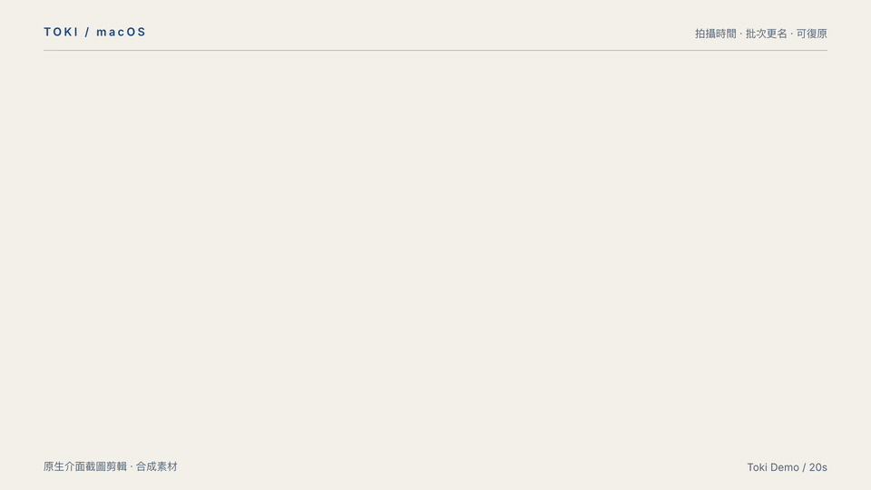

<p align="center">
  
</p>

<h1 align="center">Toki</h1>

<p align="center">讓照片與影片，回到拍攝的那一刻。</p>

Toki 是原生 macOS 批次更名工具，使用 EXIF／QuickTime 拍攝時間產生檔名。支援更名前預覽、自訂命名格式與操作復原，適合整理相機、手機及旅行影像。



## 功能

- **拍攝時間判讀**：顯示日期來源，提供 QuickTime 時區設定，不以 Finder 建立時間取代拍攝時間。
- **批次匯入**：拖入照片、影片或多個資料夾，可選擇是否包含子資料夾。
- **自訂檔名**：組合日期、時間、原檔名與流水號，保留副檔名，同名自動加序號。
- **預覽與匯出**：檢查更名結果、篩選狀態，或匯出 CSV。
- **更名與復原**：執行前確認，防止覆寫，透過操作紀錄還原檔名。

## 下載與安裝

**[下載最新版 Toki（DMG）](https://github.com/HeiTang/Toki/releases/latest/download/Toki-macos-arm64.dmg)** · [所有版本與 ZIP](https://github.com/HeiTang/Toki/releases)

適用於 **Apple Silicon（M1 或更新）／macOS 13 以上**。已內附 ExifTool，無須另外安裝工具。

1. 下載並開啟 DMG。
2. 將 **Toki.app** 拖到 **Applications**。
3. 從「應用程式」開啟 Toki。

目前尚未完成 Apple 公證。若 macOS 顯示「無法驗證開發者」，先嘗試開啟一次，
再到「系統設定 → 隱私權與安全性」按「仍要打開」。請確認檔案下載自本專案 Releases。

## 使用方式

1. 將照片、影片或資料夾拖入 Toki。
2. 檢查新檔名與日期來源；需要時在「設定 → 命名」調整格式。
3. 確認範圍後執行更名；完成後可使用「復原這次更名…」。

命名範例：

```text
{yyyy}{MM}{dd}_{HH}{mm}{ss}    → 20240229_123456.jpg
旅行_{yyyy}-{MM}-{dd}_{index} → 旅行_2024-02-29_0001.jpg
```

完整變數、時區設定與操作說明見[使用文件](docs/usage.md)。

## 開發

### 建置

需要 Xcode 或 Command Line Tools。首次建置會下載並校驗 ExifTool；尚未安裝編譯工具時，執行：

```sh
xcode-select --install
```

在專案根目錄建置並開啟 App：

```sh
./build.command
open dist/Toki.app
```

`build.command` 使用 `swiftc` 編譯目前 Mac 架構，內附 ExifTool 與圖示，執行自測並驗證簽章。
Apple Silicon 上再執行 `./release.command`，即可產生經驗證的 DMG、ZIP 與 SHA-256。產物位於 `dist/`，不納入 Git。

### 測試

建置時會自動執行全部自測。也可單獨重跑：

```sh
dist/Toki.app/Contents/MacOS/Toki --self-test
```

測試涵蓋日期與時區、EXIF 讀寫、同名碰撞、防覆寫、更名與復原、匯入、命名規則及 AppKit UI 狀態。自測會在暫存目錄建立素材，需要 macOS 圖形登入工作階段。

手動驗收可使用 `Tests/Fixtures/Import/` 的合成素材；請先複製到其他資料夾，再執行更名。

### 持續整合

[macOS Build](.github/workflows/macos-build.yml) 在 `main`／`develop` 推送及 PR 更新時，
使用 Apple Silicon runner 建置、跑全部自測、檢查封裝與簽章，提供測試包。

[Release](.github/workflows/release.yml) 在推送 `v版本號` 標籤時，自動驗證版本、建置並發布
DMG、ZIP 與校驗碼到 GitHub Releases。設定 Developer ID 憑證後，也會自動簽章與公證。
詳見[發布文件](docs/releasing.md)。

### 專案結構

```text
Sources/                 AppKit 介面、日期判讀與更名邏輯
Tests/                   核心、匯入／命名與 UI 自測
  Fixtures/Import/       手動測試素材
Resources/Info.plist     App metadata
Assets/AppIcon/          圖示母圖與 ICNS
.github/workflows/       GitHub Actions
ThirdParty/              第三方授權
scripts/                 依賴下載與封裝驗證
docs/                    使用與發布文件
build.command            建置與自測
release.command          DMG／ZIP 封裝與驗證
dist/                    建置產物（Git 忽略）
```

## 限制

- 只修改檔名，不改寫媒體內容；復原紀錄不是媒體備份。
- XMP／AAE 與 Live Photo 配對不會連動更名。
- Intel 與其他 macOS 版本尚未實機驗證。
- CI 不包含 Finder／Dock 外觀或真人拖放驗收；GitHub runner 的 AppKit 自測相容性仍需以實際執行結果確認。

bundle ID 與內部儲存鍵保留早期 PhotoDate 名稱，以沿用既有設定與復原流程。
